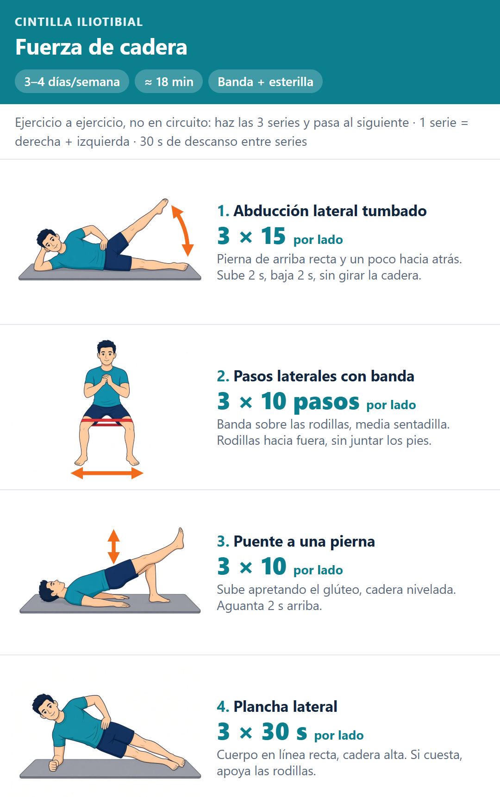
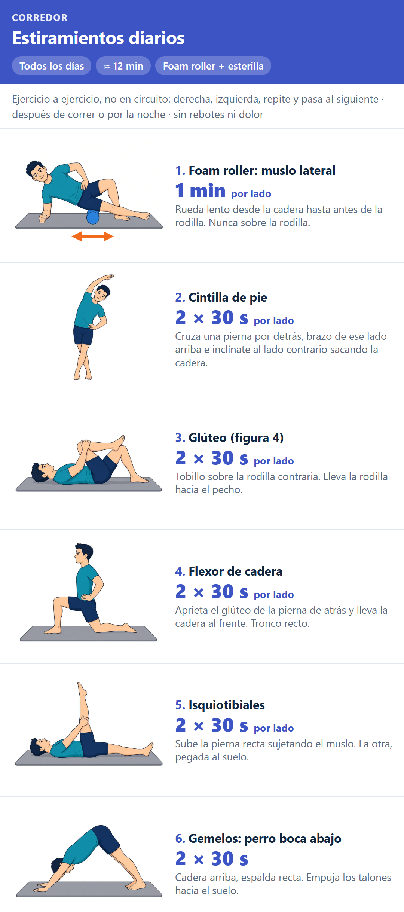

# Stretching

Dos rutinas en casa para un corredor con síndrome de la cintilla iliotibial (pierna derecha).

**Web:** https://marcos1995.github.io/Stretching/

- `index.html`: la web entera (datos, estilos y seguimiento diario en `localStorage`).
- `img/`: una ilustración por ejercicio.
- `resumen-*.png`: las fichas, exportadas de la propia web con `fichas.ps1`. La flecha naranja marca el movimiento; sin flecha, la postura se mantiene.

Guía general, no sustituye a un fisioterapeuta.
